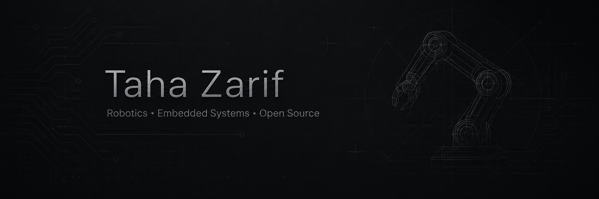

  

# Hi, I'm Taha.

I'm a high-school student who likes building software that has to work in the real world: embedded systems, robotics, industrial automation, and applied AI.

What interests me most is the part after the demo works — timing, edge cases, hardware behavior, failure modes, tests, and figuring out why something breaks when the assumptions meet reality.

I learn mostly by building things, debugging them, and contributing fixes upstream.

## What I'm working on

- **Embedded & RTOS:** Zephyr RTOS, Bluetooth host behavior, concurrency, bounded resources, and hardware-facing code.
- **Robotics & control:** C/C++, ROS 2, planning, control, odometry, and autonomous systems.
- **Industrial automation:** PLCs, Modbus TCP, servo motion, homing, interlocks, alarms, and real machine debugging.
- **Applied AI:** computer vision and grounded LLM/RAG systems, with an emphasis on reproducible evaluation rather than demo-only results.

## Open source

I contribute to projects I actually use and study, including **Zephyr RTOS, Apache NuttX, Robotics Toolbox for Python, and Motrix**.

A few examples:

- [Zephyr RTOS #119955](https://github.com/zephyrproject-rtos/zephyr/pull/119955) — reject invalid Bluetooth identities during local OOB lookup.
- [Zephyr RTOS #118971](https://github.com/zephyrproject-rtos/zephyr/pull/118971) — add public-API identity-management coverage through the real Bluetooth host path.
- [Robotics Toolbox for Python #667](https://github.com/petercorke/robotics-toolbox-python/pull/667) — fix numerical IK convergence ordering around singular solver updates.
- [Motrix #2138](https://github.com/agalwood/Motrix/pull/2138) — restore macOS Menu Bar Only behavior after the main window is dismissed.

I keep a fuller contribution record in [Engineering Evidence](./EVIDENCE.md).

## Projects I care about

### [Robotics Control Core](https://github.com/tahazarif10/robotics-control-core)
A C++20 planning and control library for differential-drive robots. It includes grid planning, path following, PID control, odometry, deterministic benchmarks, sanitizers, and CI.

### [Embedded RTOS Sensor Hub](https://github.com/tahazarif10/embedded-rtos-sensor-hub)
A Zephyr-based sensor hub focused on static resources, bounded queues, supervision, recovery behavior, fault injection, and Twister tests.

### [ROS 2 Autonomous Mobile Robot](https://github.com/tahazarif10/ros2-autonomous-mobile-robot)
A ROS 2 / Nav2 stack where I focus on lifecycle behavior, TF and QoS contracts, replayable tests, diagnostics, and fail-safe behavior.

### [Industrial Vision Inspector](https://github.com/tahazarif10/industrial-vision-inspector)
A reproducible OpenCV/PyTorch defect-classification pipeline with deterministic data preparation, training, inference, and calibration-aware evaluation.

### [Grounded LLM Platform](https://github.com/tahazarif10/grounded-llm-platform)
A small RAG platform built around explicit retrieval, provenance, structured outputs, citation checks, abstention, and measurable evaluation.

## How I like to work

I prefer small, explainable changes over clever ones. I try to reproduce a problem before fixing it, add a regression test when it is practical, and keep claims proportional to what the code and tests actually prove.

I also enjoy the hardware/software boundary. A bug caused by a timing assumption, an encoder edge, a servo parameter, or a protocol detail is usually more interesting to me than a polished UI with no difficult engineering underneath.

## Tools I use

**C · C++ · Python · C#/.NET · Zephyr RTOS · ROS 2 · Nav2 · OpenCV · PyTorch · FastAPI · Docker · CMake · GitHub Actions · PLC / Modbus / Servo Automation**

## A little more about me

Robotics is what pulled me into engineering in the first place. I competed with **Kamaan Shahriar Iran** at the **FIRA RoboWorld Cup 2024** in São Luís, Brazil, where our team placed **4th in Cliff Hanger Lightweight (U14)**.

I'm still early in the journey, which is exactly why I like open source: good code review makes weaknesses visible, and real projects are much better teachers than isolated exercises.

---

[Resume](./RESUME.md) · [Engineering Evidence](./EVIDENCE.md) · [LinkedIn](https://www.linkedin.com/in/taha-zarif-bba94b397/) · [Repositories](https://github.com/tahazarif10?tab=repositories)
